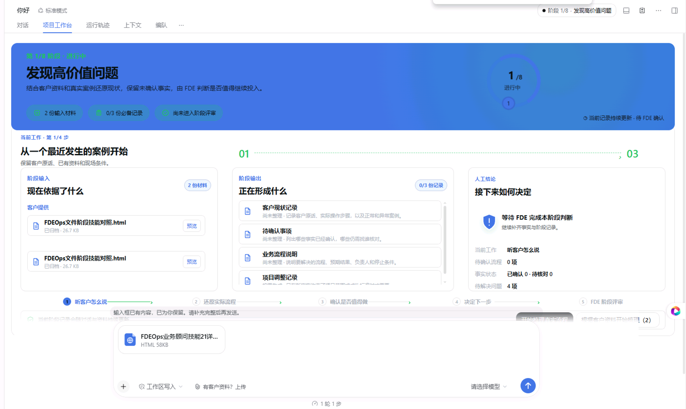

# 基于 Deepseek Harness 的 AI Web 工作台。

## 基本功能

1. 在 Deepseek Harness (https://github.com/deepseek-ai/deepseek-harness)界面的左边栏第一个选项的上面增加入口：Web 工作台。注意，这里最好是以 Deepseek Harness 插件的形式来增加入口，尽量和 Deepseek 源码解耦，不要改动 Deepseek 源码，因为还要保留 Deepseek Harness 更新的能力。

2. 点击 Web 工作台进入的界面是项目中心，数据是以项目为顶层维度管理的。项目包含 4 个 部分：需求管理、流程管理、技能管理、成员管理；单个项目界面可以 Tab 的形式横向切换这几个部分，有点类似 Github 打开一个项目后切换 Code、Issue、Pull Request 那样。

3. 成员管理

   - 项目创建人默认为项目 owner，owner 可以添加/删除普通成员，可以管理项目(删除、编辑等)。
   - owner 可以转让给项目普通成员。

4. 技能管理：技能就是 Agent 的 skill，暂时先只支持手工上传技能，有未完成实例引用技能时不能删除技能。

5. 流程管理：

   - 增删改查流程
   - 支持流程节点编排，不用那种可以自由拖拉的，只要一个节点列表就行，执行顺序就是从上到下，可以调整通过拖拉列表项上下调整顺序，点击节点展开
   - 定义每个节点需要的内容
     - 输入：输入类型可选择自由输入或者固定输入，固定输入时支持添加/删除固定输入项。
     - 输出：输出只能是固定输出项，支持添加/删除固定输出项。
     - 可用技能：列出技能管理中的技能以供选择。

6. 需求管理

   - 增删改查需求

   - 创建需求时，要选择绑定的流程，一个需求只绑定一个流程，需求创建后会启动流程实例和需求绑定。

   - 点击需求进去查看需求流程实例界面，可以查看流程流转。

   - 打开流程实例的当前节点时的界面参考【重要！核心！】：

     

     

     这个界面只是作为布局参考，样式和内容都不是这样的哈。

     内容大致只要：

     - 顶部的 tab 中的会话要保留，以便查看完整会话过程；第二个 tab 不叫项目工作台，叫节点信息，其他 tab 不要。

     - 节点信息 tab 内容部分：先是节点名称，然后就是上一节点输出、流程节点中的输入、输出。
       - 输入这一块的名称就叫节点输入，如果是自由输入则在“节点输入”的右边添加上传按钮，上传后列出在节点输入这一块；如果是固定输入则展示输入项是是什么，输入项的右边出现上传按钮
       - 输出：对话时带上节点输入、上一节点输出、节点skill 和本节点已有输出等信息的引用给到模型，与模型多轮对话补齐信息，模型在对话中要能查看这些引用的真实文件，要能使用 节点 skill，最终让模型完整输出指定的输出项。输出后页面上可以下载，下载按钮在每个输出项的右边。所有输出项都完成后进入下一个节点
       - 最下面就是对话框了，这个会话就是用的 Deepseek Harness 的会话，看下是不是可以用插件实现。

   - 如果是打开非当前节点：即只读状态，较当前节点去除会话的东西就行包括会话框和会话 tab。

7. 默认内置技能：每个节点都默认内置一个指导技能，指导大模型怎么去获取需要输出哪些东西、怎么输出、输出的东西要怎么存取才能让页面上能看到能下载能跨会话跨节点保存。

8. 用户管理

   模拟做一个注册和登录，要注册过才能登录，注册只要随便填个用户名称就行。

8. 项目中心

   展示项目列表，只展示当前登录人员所属的项目

9. 权限管理

   - 只有项目成员有权限操作项目内的东西

   - 项目 owner 有操作项目内一切的权限

   - 其他项目成员只有管理自己创建/上传的数据的权限；只能推进自己的需求流程，进入别人的需求流程所有节点都是只读的，当前节点也是只读的。

   - 项目成员默认有项目内所有信息的读取权限

## 开发要求

1. 前后端分离，后端使用 Java、SpringBoot、Spring MVC、分模块、三层架构，mybatis、mysql （192.168.2.125:3306 root 密码见本地环境配置（勿入库） 要新建数据库，要提供建库建表、变更表结构等的语句脚本，方便在其他地方部署）
2. 要与 DeepSeek Harness 解耦，要保留 Deepseek Harness 的升级能力。
3. 页面风格就参考 Github 吧